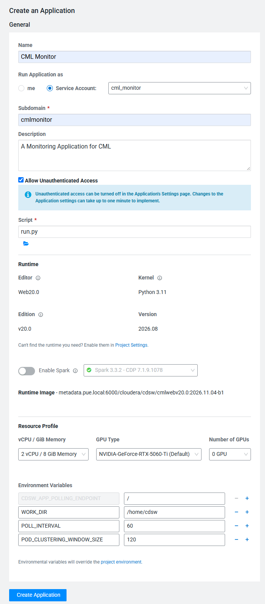
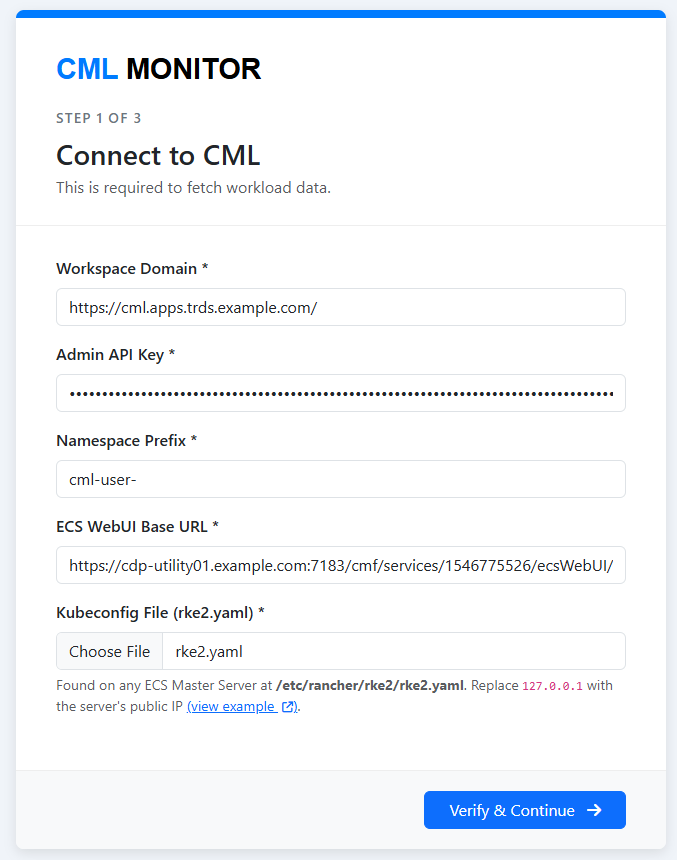
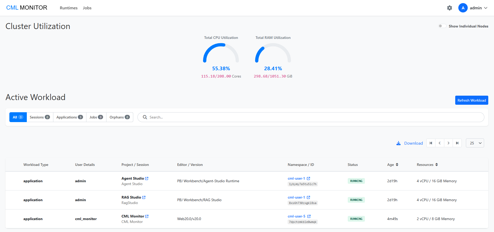

# CML Monitor

> **⚠️ VERY IMPORTANT DISCLAIMER ⚠️**
> 
> This project is an independent effort and is **NOT an official Cloudera product**. It has **not** been tested for security vulnerabilities or issues. It is **highly recommended** to deploy and run this application strictly in a secure, no-internet (air-gapped) environment. Use at your own risk.

---

## Overview

**CML Monitor v2.0** is a Flask-based web application designed to serve as a comprehensive, proactive administrative console for Cloudera Machine Learning (CML), recently renamed to [Cloudera AI](https://docs.cloudera.com/machine-learning/cloud/product/topics/ml-product-overview.html). 

The application connects to the underlying Kubernetes cluster running on Cloudera ECS Hosts via an `rke2.yaml` configuration file. It uses this configuration to look up all running Kubernetes pods and intelligently matches them with active workloads on CML via the CML API. Version 2.0 introduces an enterprise-grade architecture utilizing Valkey/Redis for decoupled, asynchronous data syncing, enabling lightning-fast UI responsiveness and real-time metric tracking.

## Features

* **Unified Dashboards & Metrics:** Centralized pages for active workloads, cross-project jobs, and available runtimes. Includes live, 3-second updates on cluster-wide worker node CPU and RAM utilization.
* **Smart Stuck Workload Detection:** Automatically identifies orphaned Kubernetes pods, workloads with dead Spark executors, and stalled job schedules (e.g., jobs stuck running while a parent job has already completed a newer run).
* **Advanced Search & Visibility:** Apache Ranger-style Multi-Parameter Search with smart auto-complete. Workloads include direct links to CML projects, Runtime Editor versions, and Kubernetes namespaces.
* **Role-Based Visibility & UI User Management:** Manage local and LDAP users directly from the UI. Users see only their workloads unless granted admin rights (`is_admin`).
* **Automated Alerts & Dry Runs:** Background processes monitor the cluster to send alert emails for "zombie" sessions and scheduled summary reports via SMTP. Safely test these notifications using the new Alert Dry Run feature.
* **In-App Configuration & Log Streaming:** A dedicated settings UI for authorized admins (`config_admin`) to modify CML, LDAP, and Alert parameters on the fly, alongside live Application Log streaming directly within the browser.

---

## Deployment & Setup Flow

The application is built to run natively as a **CML Application** using a custom runtime called `CMLWeb`. Version 2.0 massively simplifies this build process.

### 1. Build the Custom Runtime (`CMLWeb`)
You no longer need to clone external Cloudera repositories. All files needed to build a custom Jupyter runtime with the required Python packages are bundled in this repository.

1. **Clone this repository:**
   ```bash
   git clone https://github.com/abdo-soliman/CMLMonitor
   cd CMLMonitor
   ```

2. **Build the Docker Image:**
   Run the following command to build the image (disabling the cache ensures you get the latest base layers):
   ```bash
   docker build --no-cache -t cmlweb:v20.0 .
   ```

3. **Save the Image as a Tarball:**
   First, find the Image ID of your newly built runtime:
   ```bash
   docker images | grep cmlweb
   ```
   Copy the `<image_id>` and save the image to a tar file so it can be uploaded and added to your CML environment as a custom runtime:
   ```bash
   docker save -o cml-webv20.0.tar <image_id>
   ```

### 2. Application Creation on CML
CML Monitor is meant to run as an administrative CML Application. It is highly recommended to create a dedicated **Machine User** (e.g., `cml_monitor`) with `EnvironmentUser` and `ML Admin` privileges to run the application securely. Add this user as a Collaborator to your CML project.

Once the repo files are uploaded to your project and the runtime is registered, create the Application with these parameters:

* **Script:** `run.py` (Uses Gunicorn to serve the Flask application and background daemons).
* **Run as Service Account:** Select your newly created Machine User (e.g., `cml_monitor`).
* **Resource Profile:** Minimum recommended resources are **2 vCPU and 8 GiB Memory**.
* **Environment Variables:**
    * `WORK_DIR`: Path to the uploaded files (e.g., `/home/cdsw`).
    * `POLL_INTERVAL`: `60` (Time in seconds for the background workload cache to refresh).
    * `POD_CLUSTERING_WINDOW_SIZE`: `120` (CML API query window in minutes to prevent overloading the API on busy clusters).

> ****

### 3. Initial Application Boot
When the application is launched for the very first time, it follows a strict initialization sequence:

1.  **Create Admin Page:** If the database (SQLite) has no users, the application forces the creation of a local system administrator. Submitting this form initializes the tables and redirects to the login screen.
2.  **Login Page:** Standard authentication interface. 
3.  **Initial Setup Wizard:** Upon logging in, if the application detects it has not been configured (the `init` attribute in the DB is `0`), the admin is redirected to a 3-step setup wizard:
    * **Step 1: CML Configs (Mandatory):** Requires the CML Workspace Domain, an Admin API Key, the Kubernetes namespace prefix (e.g., `pue-test-ai-user-`), the `rke2.yaml` file (found on any ECS Master Server), and the **ECS Web UI Base URL**.
    * **Step 2: LDAP Configs (Optional):** Active Directory settings for organizational user sync.
    * **Step 3: SMTP Alerts (Optional):** Email routing settings for automated reports and alerts.

> ****
> ****

---

## Configurations

Application settings are accessible via the UI for users with the `config_admin` privilege. Version 2.0 expands these tabs to include comprehensive administrative controls:

* **CML Configs (Mandatory):** The application cannot function without valid CML API credentials and the Kubernetes config file. 
* **LDAP Configs (Optional):** Enables LDAP authentication. Standard LDAP users logging in will only see the workloads they have explicitly launched.
* **Alerts Configs (Optional):** Manages automated email routines based on cron expressions. Includes the new **Alert Dry Run** feature.
* **User Management (New):** Add, edit, delete, and toggle roles (`is_admin`, `config_admin`) for users directly from the UI.
* **System Logs (New):** Live streaming of internal application logs and background sync threads with auto-scrolling, eliminating the need to parse raw CML logs.

---

## User Management (CLI)

> **Note on v2.0:** Full User Management is now integrated directly into the web UI via the Configurations page. However, the command-line script `cmlmonitor_db.py` remains available for backend operations or disaster recovery.

### Create a User
Creates a local user. Use the flags `--is-admin` to allow the user to see all cluster workloads, and `--config-admin` to grant access to the settings page.
```bash
python cmlmonitor_db.py user create -u [username] -p [password] -m [email] -f [fullname] --is-admin --config-admin
```

### Update an Existing User
Modifies user details or privileges. *Note: If the user is an LDAP user, only their privileges (`--is-admin` / `--config-admin`) can be updated.*
```bash
# Add or revoke privileges using the respective flags
python cmlmonitor_db.py user update -u [username] -p [password] -m [email] -f [fullname] --is-admin --no-config-admin
```

### Delete a User
Removes a user entirely from the local database.
```bash
python cmlmonitor_db.py user delete -u [username]
```

---

## Database Architecture

The backend utilizes **SQLite** paired with **Alembic (Flask-Migrate)** for seamless schema migrations, allowing for application updates without reinstallation. Real-time workload states are cached asynchronously using a local **Valkey/Redis** instance.

Below is an overview of the core SQLAlchemy models:

* **`User` Model:** Manages authentication and authorization flags.
    * Stores `username`, `password` (nullable for LDAP/external users), `mail`, and `fullname`.
    * **Roles:** `is_admin` (View all workloads) and `config_admin` (Access configuration page).
* **`Config` Model:** Stores dynamic application settings as Key-Value pairs. Tracks the `updated_by` user via a foreign key relationship to ensure accountability.
* **`Runtime` Model:** Stores synced CML runtimes (Images, Editor Names, Versions, and ENABLED/DISABLED statuses).
* **`Job` Model:** Stores synced CML Jobs to build the unified Jobs dashboard, tracking schedules, resource requests, and real-time execution states.
